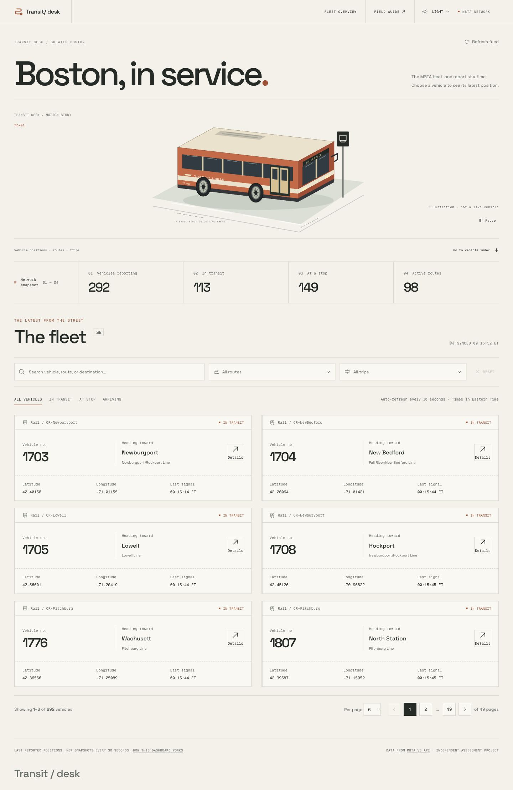

# Transit Desk

A fleet monitoring application with an editorial transit-observatory interface, built with **Next.js App Router, React, TypeScript, and Tailwind CSS v4**. It turns the public MBTA vehicle feed into a searchable, filterable workspace with vehicle details and an interactive map.

Created for the Transjakarta frontend assessment. **The live data covers Greater Boston; this is not an official MBTA or Transjakarta product.** All application copy, functions, files, and documentation use English.



## Run locally

Requires Node.js 22 or newer and npm. Internet access is needed for the MBTA API and map tiles.

```bash
npm ci
cp .env.example .env.local
npm run dev
```

Open http://127.0.0.1:3000. A public MBTA key is not required for low-volume use. To use your own key, set `MBTA_API_KEY` in `.env.local`; it is only sent by the Next.js server.

```bash
npm run build
npm start
```

The production build uses Next.js's supported Webpack builder. The local sandbox blocked Turbopack's build-worker port binding, while Webpack compiled successfully. Development uses Next.js's default Turbopack server.

## Features

- Vehicle cards with label, status, coordinates, and original update timestamp.
- Exact matching record count, range, page count, previous/next and numbered navigation.
- Page sizes of 6, 12, and 24 vehicles.
- Multiple routes and trips, lazy-loaded from their own API endpoints in batches of 25.
- Infinite scrolling using `IntersectionObserver`, plus an explicit Load more button.
- Search within loaded dropdown options, clearly labelled; load additional pages for additional matches.
- Vehicle/destination search and status filters.
- Popup details with fresh vehicle data, route, trip, direction, stop, occupancy, speed, and Leaflet/OpenStreetMap position.
- Skeletons, empty results, friendly errors, retry actions, missing-coordinate handling, and stale-data preservation.
- A fresh fleet snapshot every 30 seconds while active, plus manual refresh.
- Responsive layouts, keyboard-accessible popovers and dialogs, focus management, skip link, and reduced-motion support.

## Rendering strategy

| Surface                                         | Rendering                                   | Reason                                                                                |
| ----------------------------------------------- | ------------------------------------------- | ------------------------------------------------------------------------------------- |
| `/` initial fleet                               | SSR, `force-dynamic`, uncached API request  | Current vehicle data is present in the HTML on every request.                         |
| Filters, pagination, refresh, dialog            | Hydrated client components / CSR            | Immediate interaction without a route transition.                                     |
| Leaflet map                                     | CSR, dynamically imported with `ssr: false` | Browser-only dependency, loaded only when details are opened.                         |
| `/guide`                                        | SSG, `force-static`                         | Stable explanations and FAQs are crawlable, fast, and independent of the transit API. |
| `/robots.txt`, `/sitemap.xml`, Open Graph image | Static metadata routes                      | Predictable crawler and share metadata.                                               |
| `/api/transit/*`                                | Dynamic Next.js route handler               | Same-origin API boundary and optional server-only API key.                            |

## Architecture

The project follows the requested [frontend-architecture skill](https://github.com/stareezy-1/frontend-architecture-skill/blob/main/skills/frontend-architecture/SKILL.md).

```text
src/
  app/                         # Thin routes, providers, metadata, API gateway
  modules/
    fleet/
      index.ts                 # Public boundary
      hooks/                   # TanStack Query hooks and key factory
      services/                # MBTA requests and JSON:API normalization
      stores/                  # Zustand UI state, isolated per provider
      types/                   # API contracts and view models
      utils/                   # Pure filtering/pagination + tests
      pages/fleet-overview/
        fleet-overview.tsx
        fleet-overview.styles.ts
        components/            # Page-local components and styles
    guide/                     # Static guidance and visible FAQ content
  shared/
    api-client/                # Single typed fetch client, timeout, errors
    seo/                       # Site origin and safe JSON-LD serialization
    utils/                     # Class composition
```

- **Server state:** TanStack Query owns API responses, loading/error state, cache, and refresh. Responses are never copied into Zustand.
- **UI state:** A per-provider Zustand store owns route/trip selections, search, status, page size, page, and the selected vehicle ID. Stores are not shared across SSR requests.
- **Data access:** Components only use data hooks. Services use one typed `apiRequest` client. Browser calls pass through `/api/transit`; server rendering calls MBTA directly using the same client.
- **Public boundaries:** Routing imports from module barrels. Components stay local until another consumer needs them.
- **Styling:** Tailwind class maps live in colocated `.styles.ts` files. Semantic tokens live in `globals.css`; status variants use CVA. Open Graph image styles are the documented exception required by the image renderer.
- **Visual direction:** Space Grotesk typography, readable mono labels, warm-paper and charcoal themes, and a panoramic SVG bus study below a compact workspace masthead, with a boarding animation. The dark theme uses neutral graphite rather than green-tinted surfaces. System appearance is the default; Light and Dark overrides persist across routes and visits. Motion has pause and reduced-motion controls.

## API behavior and tradeoffs

MBTA's `/vehicles` endpoint does **not** allow `filter[trip]` together with other vehicle filters. To support simultaneous multi-route and multi-trip filtering, the app loads the full vehicle snapshot using `page[limit]=1000`, follows any `links.next`, normalizes relationships, and deduplicates vehicle IDs. Filters and pagination operate on this complete snapshot. OR applies within a selection, AND across categories. This makes the displayed totals exact for that fetched snapshot. The upstream feed can change while multiple pages are being read; this is not an atomic server snapshot.

This is suitable for MBTA's current fleet size. A substantially larger network should move combined filtering and counting into a server-side aggregation layer.

Routes use `/routes` with `sort=sort_order`. Trips require at least one API filter; the app uses `filter[revenue]=REVENUE`, adding `filter[route]` when routes are selected. It does not assume a user's calendar date corresponds to the API's active schedule. Scheduled trips may have no active vehicle, producing a valid empty result. Changing routes clears trip selection to prevent incompatible hidden selections.

Fleet requests use a 15-second timeout and abort signals. Queries retry transient errors once; 400, 404, and 429 do not auto-retry. Data refreshes every 30 seconds, not on every focus change. A failed refresh retains the last successful snapshot and displays an error. Detail requests fetch again when the popup opens; missing positions do not render a misleading map.

Times are formatted explicitly in `America/New_York`, consistently on server and client. The network sync time and each vehicle's source update time are distinct.

## Theme system

`next-themes` resolves the operating system preference by default. The shared header control offers System, Light, and Dark. Overrides are stored under `transit-desk-theme`; selecting System resumes automatic system updates. Semantic tokens in `globals.css` theme every application surface. The provider applies the resolved theme before hydration to avoid a wrong-theme flash. With JavaScript unavailable, the CSS media fallback still follows the system.

The bus is an illustration, not real-time telemetry. Its 12-second CSS timeline combines travel, a boarding pause, and departure without animation timers or frame-by-frame React updates.

## SEO, GEO, and AEO

- SSR vehicle content and semantic headings, plus a fully static field guide.
- Unique page titles/descriptions, canonical URLs, English language declaration, Open Graph image, and Twitter metadata.
- Sitemap, robots rules, and an API path excluded from crawling.
- `WebApplication`, `FAQPage`, and `BreadcrumbList` JSON-LD. FAQ markup is generated from the same content shown on the page.
- Direct answers to specific questions, clear entity/geographic scope, and original MBTA/OpenStreetMap source links.
- `/llms.txt` offers a concise optional context index for tools that consume it.

Set `NEXT_PUBLIC_SITE_URL` to your actual HTTPS origin **before building for deployment**. It controls canonical, sitemap, structured-data, and share URLs. Local defaults intentionally point to localhost. These features support discoverability and accurate interpretation; they do not guarantee search ranking, rich results, or citation by an AI answer engine. `llms.txt` is an optional convention, not a ranking requirement.

## Validation

```bash
npm run typecheck
npm test
npm run build
npm run format:check
```

Browser tests use deterministic API fixtures in Playwright. Start the app in another terminal, then run:

```bash
npm run dev
# In another terminal:
npm run test:e2e
```

Playwright uses installed Google Chrome (`channel: 'chrome'`). Change the channel or install the appropriate browser for CI. The initial SSR request may access MBTA; interactive test requests are intercepted. `node tests/visual-check.mjs` exercises the **real API**, captures screenshots, and reports browser errors. It needs the server running at port 3000 and an available upstream feed.

See the [complete implementation video script](docs/video-script.md), [assessment coverage](docs/assessment-coverage.md), [validation evidence](docs/validation.md), and the [5–10 minute demo outline](docs/demo-guide.md).

## Delivery status

Public source: [stareezy-1/transit-desk](https://github.com/stareezy-1/transit-desk). The repository includes a [complete timed video script](docs/video-script.md) and [main-flow recording outline](docs/demo-guide.md). Recording and submitting the demo video, and public application deployment, remain separate delivery steps.

## Repeatable assessment audit

See [the PDF audit](docs/pdf-audit.md) for the requirement matrix and fixes. To run the same deterministic UI against a local fixture API, use two terminals:

```bash
node tests/support/fixture-server.mjs
# Separate terminal:
TRANSIT_QA=1 TRANSIT_TEST_API_ORIGIN=http://127.0.0.1:4319 npm run dev -- --port 3002
```

Open `http://127.0.0.1:4319/__control` to select loading, failure, empty, missing-position, malformed-response, or shrinking-fleet scenarios. Audit `http://127.0.0.1:3002` at desktop/mobile widths in both themes. The ordinary app on port 3000 continues to use MBTA. The fixture service is loopback-only, development-only, and must not be deployed. Stop both test processes when finished.

## Usability refinements

Active filter chips can be removed individually. Clearing filters preserves the selected page size. Mobile pagination includes a direct page picker. Changing pages returns focus to the new results, while closing details returns to the originating card. Destination names wrap on narrow screens. See [the UX review](docs/ux-review.md) for rule-based findings and the eight-configuration interaction checks.
